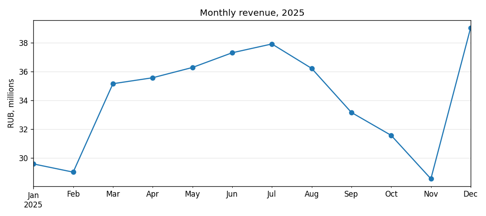
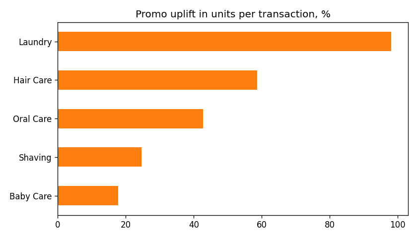

# FMCG Sales Analysis with pandas

End-to-end analysis of one year of retail sales for a household & personal care portfolio
(laundry, hair care, oral care, shaving, baby care): data cleaning, merging reference tables,
KPI calculation, promo effectiveness and store segmentation.

The dataset is synthetic (generated by `generate_data.py`) but shaped like real retail data:
seasonality, a New Year peak, different store formats, brand leaders and promo campaigns.
The raw file is intentionally dirty, so cleaning is part of the task.

## Data

| File | Rows | Description |
|---|---|---|
| `data/sales_raw.csv` | 60,300 | Transactions: date, store, SKU, units, price, promo flag |
| `data/products.csv` | 45 | SKU reference: brand, category, list price |
| `data/stores.csv` | 40 | Store reference: city, region, format, opening date |

## Pipeline (`analysis.py`)

1. **Load** three CSV files.
2. **Clean**
   - remove 300 exact duplicate rows;
   - normalise the promo flag (`Y`, ` Y`, `yes`, empty → boolean);
   - split 150 returns (negative units) into a separate table;
   - fill 150 missing prices with the median price of the same SKU;
   - fix inconsistent city names (`" MOSCOW "` → `Moscow`).
3. **Merge** sales with products and stores (`validate="many_to_one"` guards against key duplicates).
4. **Analyse**
   - monthly revenue and month-over-month growth;
   - revenue share by category and top brands;
   - promo uplift: units per transaction with vs. without promo, by category;
   - region × category pivot table;
   - ABC analysis of stores (A = first 80% of revenue);
   - returns rate by category.
5. **Report**: CSV tables and PNG charts in `outputs/`.

## Key findings

- Total revenue for 2025: **409 M RUB**; December is the peak month (**+37% MoM**).
- Baby Care is the largest category (**~35% of revenue**), Oral Care the smallest (~8%).
- Promo response differs strongly by category: **Laundry +98%** units per transaction,
  Baby Care only **+18%** → promo budget is better spent on laundry and hair care.
- **26 of 40 stores** generate 80% of revenue (ABC class A).




## How to run

```bash
pip install -r requirements.txt
python generate_data.py
python analysis.py
```

## Stack

Python · pandas (groupby, merge, pivot_table, transform, cut, Period) · matplotlib
